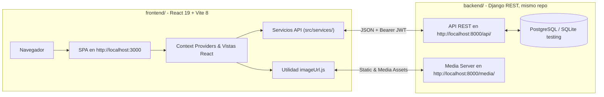

# Arquitectura del Frontend y Diagrama de Componentes (TP5 a TP9)

> Especificación arquitectónica del cliente React SPA (Vite) y su integración con el backend Django REST Framework.

## 1. Arquitectura General (Dos Capas + Multimedia)



- El frontend es una Single-Page Application pura que consume la API en formato JSON.
- Autenticación sin estado con tokens JWT (`access` y `refresh` en `localStorage`).
- Las imágenes de productos y comercios se sirven de forma estática desde el backend con normalización y fallback en frontend.

## 2. Árbol de Componentes y Jerarquía de Vistas

```mermaid
flowchart TD
    App[App - Router & Layout]
    Providers["Providers: AuthProvider · CartProvider · AddressProvider"]
    
    App --> Providers
    Providers --> Navbar[Navbar]
    Providers --> Routes[React Router Views]
    Providers --> Footer[Footer]
    Providers --> BottomNav[BottomNav Móvil]

    Routes --> Home[Home]
    Routes --> Stores[Stores / Explorar]
    Routes --> StoreDetail[StoreDetail]
    Routes --> Cart[Cart]
    Routes --> Checkout[Checkout]
    Routes --> Profile[Profile / Pedidos]
    Routes --> PanelTienda[PanelTienda / Panel de Tienda]
    Routes --> Login[Login]
    Routes --> Register[Register]

    Navbar --> AddressModal[Modal Selector de Dirección]
    Navbar --> AuthMenu[Menú de Usuario / Carrito]

    Home --> Hero[Hero]
    Home --> CategoryList[CategoryCard x5]
    Home --> FeaturedStores[StoreLogo xN]

    Stores --> StoreFilters[Selector de Categorías]
    Stores --> StoreGrid[StoreCard xN]

    StoreDetail --> ProductGrid[ProductCard xN]
    ProductGrid --> ProductModal[ProductDetail Modal]

    Cart --> CartItemList[CartItem xN]
    Cart --> CartSummary[Subtotal & Checkout CTA]

    Checkout --> CheckoutForm[Dirección & Teléfono Autocompletados]
    Checkout --> PaymentSelector[Método de Pago]
    Checkout --> OrderSummary[Resumen del Pedido]

    Profile --> AddressManager[Gestor de Direcciones Guardadas]
    Profile --> OrderHistory[Historial Cronológico de Pedidos]

    PanelTienda --> VendorOnboarding[Onboarding de Tienda]
    PanelTienda --> EditarTiendaModal[EditarTiendaModal]
    PanelTienda --> ProductoModal[ProductoModal]
    PanelTienda --> VendorOrdersMonitor[Monitor de Pedidos y Cocina]
```



## 3. Componentes Clave y Responsabilidades

| Componente | Responsabilidad |
| :--- | :--- |
| `App` | Configuración de BrowserRouter, enrutado client-side y composición de providers. |
| `AuthProvider` | Manejo de tokens JWT, usuario actual, login, registro, logout con blacklist, silent refresh y actualización de roles (`updateUser`). |
| `CartProvider` | Carrito mono-tienda reactivo sincronizado con backend (`CartService`), cálculo de totales y stock. |
| `AddressProvider` | Gestión de direcciones guardadas, persistencia en storage y selección de dirección de envío activa. |
| `Navbar` | Navegación superior responsive, logo, selector de dirección, link a tiendas/carrito y menú de usuario / mi tienda. |
| `Home` | Portada principal con categorías interactivas, comercios destacados y acceso rápido a catálogos. |
| `Stores` | Catálogo de comercios con buscador en tiempo real y filtrado por categorías gastronómicas. |
| `StoreDetail` | Perfil del comercio, cartas de productos filtrables y modal interactivo para agregar al carrito. |
| `ProductCard` | Tarjeta de producto con foto real, badge de disponibilidad, selector de cantidad y modal accesible. |
| `Cart` | Lista de productos en carrito, botones `+`/`-` con bloqueo de límite, control mono-tienda y subtotal. |
| `Checkout` | Formulario transaccional con prellenado de dirección/teléfono, pago simulado y confirmación atómica. |
| `Profile` | Pestañas sincronizadas (`/perfil` y `/pedidos`), gestión de direcciones y seguimiento de órdenes. |
| `PanelTienda` | Portal administrativo para tiendas: onboarding, métricas, CRUD de productos, toggle `is_available` y monitor de cocina. |
| `EditarTiendaModal` | Modal de edición de datos, descripción y logo del comercio gastronómico. |
| `ProductoModal` | Modal de alta y edición de productos de la carta con precio, stock, descripción e imagen. |
| `BottomNav` | Navegación fija inferior para dispositivos móviles (< 768px). |

## 4. Matriz de Rutas Client-Side

| Ruta | Vista | Nivel de Acceso | Componente Principal |
| :--- | :--- | :--- | :--- |
| `/` | Portada / Home | Público / Auth | `Home.jsx` |
| `/tiendas` · `/explorar` | Catálogo de Tiendas | Público | `Stores.jsx` |
| `/tiendas/:id` | Detalle del Comercio | Público | `StoreDetail.jsx` |
| `/carrito` | Carrito de Compras | Autenticado | `Cart.jsx` |
| `/checkout` | Confirmación y Pago | Autenticado | `Checkout.jsx` |
| `/perfil` | Perfil y Direcciones | Autenticado | `Profile.jsx` (tab perfil) |
| `/pedidos` | Historial de Pedidos | Autenticado | `Profile.jsx` (tab pedidos) |
| `/panel-tienda` | Panel de Vendedor y Cocina | Autenticado (`vendedor`, `admin`, `cliente`) | `PanelTienda.jsx` |
| `/login` | Iniciar Sesión | Solo Invitados | `Login.jsx` |
| `/register` | Crear Cuenta | Solo Invitados | `Register.jsx` |

## 5. Flujo de Navegación Principal del Usuario

```
[Home / Explorar]  ──►  [Filtro / Selección de Tienda]  ──►  [Carta del Comercio]
                                                                     │
                                                         (Agregar al Carrito)
                                                                     ▼
[Historial / Pedidos]  ◄──  [Confirmación]  ◄──  [Checkout]  ◄──  [Carrito]
```

1. **Exploración:** El usuario ingresa a la Home o al catálogo `/tiendas`, filtra por categoría o busca por nombre.
2. **Selección:** Ingresa a `/tiendas/:id`, visualiza la oferta de productos con fotos reales e información de stock.
3. **Carrito:** Agrega productos (respetando la regla mono-tienda), ajusta cantidades y procede al checkout.
4. **Checkout Transaccional:** Se precompletan su dirección activa y su teléfono; selecciona método de pago y confirma.
5. **Confirmación y Seguimiento:** Se procesa la orden mediante `OrderService.create_order_from_cart()`, se vacía el carrito y se redirige a `/pedidos` con el historial actualizado y badges de estado.

## 6. Flujo de Datos y Capa de Servicios (`src/services/`)

* Las llamadas HTTP se centralizan en módulos desacoplados bajo `src/services/` sin lógica de API en componentes:
  * `authService.js`: peticiones a `/api/token/`, `/api/register/`, `/api/logout/`.
  * `storeService.js`: peticiones a `/api/stores/`, `/api/stores/my-store/`.
  * `productService.js`: peticiones a `/api/products/`.
  * `cartService.js`: peticiones a `/api/carts/` y `/api/cart-items/`.
  * `orderService.js`: peticiones a `/api/orders/`, `/api/orders/?store=:id`.
  * `profileService.js`: peticiones a `/api/profile/`.
* `src/utils/imageUrl.js` encapsula la lógica de resolución entre URLs absolutas, rutas de Django Media (`/media/`) y placeholders ante errores de carga.

## 7. Estado de Implementación (Hitos Completados)

- [x] Andamiaje base de Vite + React en `frontend/` (TP5)
- [x] Maquetado responsive con Bootstrap 5 y Poppins (TP6)
- [x] Enrutado client-side con React Router y rutas protegidas (TP7)
- [x] Integración de Autenticación JWT con backend Django REST (TP8)
- [x] **Milestone 1 Completado:** Catálogo real, tiendas, productos y carrito mono-tienda (TP9 - M1)
- [x] **Milestone 2 Completado:** Checkout transaccional, historial de pedidos y perfil con direcciones (TP9 - M2)
- [x] **Milestone 3 Completado:** Panel de vendedor, onboarding, menú con toggle `is_available` y monitor de cocina (TP9 - M3)
- [x] **Assets Multimedia:** Aprovisionamiento de imágenes reales para 6 tiendas y 29 productos con fallback
- [x] **Aseguramiento de Calidad:** 139 tests unitarios e integrados pasando con Vitest y 60 tests en backend Django