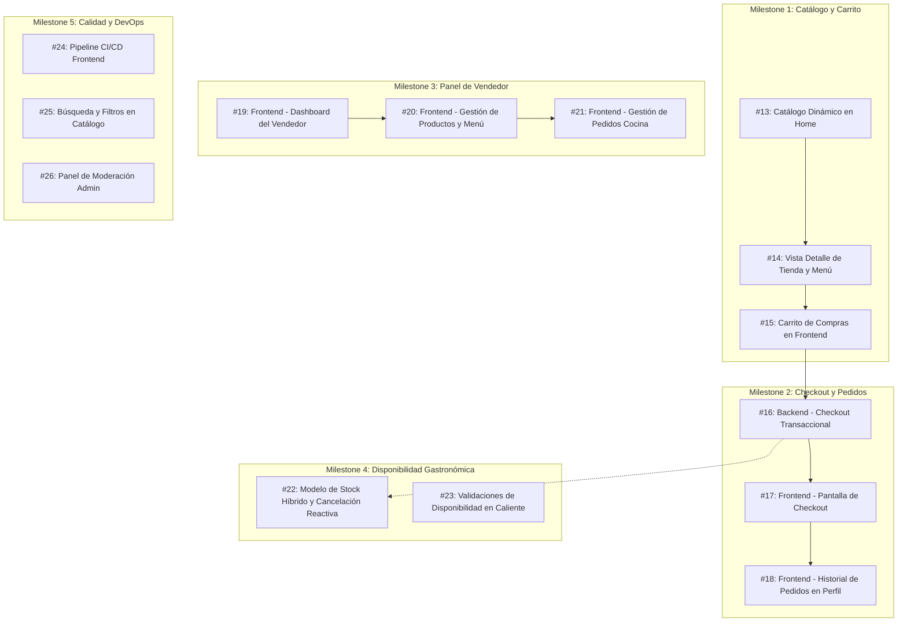

# 📋 Plan de GitHub Issues y Sub-Issues: FoodRush

Este documento organiza todas las ideas, requerimientos técnicos y funcionalidades pendientes extraídas de la documentación del proyecto (`ESTADO_ACTUAL.md`, `README.md`, `docs/`, `tps/`).

> 🚀 **Estado en GitHub:** Todas las issues listadas a continuación han sido creadas en el repositorio con sus etiquetas y asignadas a sus respectivos *Milestones*.

---

## 🏷️ Taxonomía de Etiquetas (Labels)

* `backend`: Cambios en Django / DRF (`#0052cc`).
* `frontend`: Cambios en React / Vite / Bootstrap (`#1d76db`).
* `feature`: Nueva funcionalidad de usuario (`#0e8a16`).
* `enhancement`: Mejora sobre algo ya existente (`#a2eeef`).
* `bug`: Corrección de error o caso de borde (`#d73a4a`).
* `devops`: CI/CD, configuración, entornos (`#5319e7`).
* `role:cliente`: Funcionalidades de cara al comprador (`#fbca04`).
* `role:vendedor`: Funcionalidades del dueño de comercio (`#e99695`).
* `role:admin`: Funcionalidades de moderación y plataforma (`#b60205`).

---

## 🎯 Milestones (Hitos)

1. [**M1: Catálogo Real y Carrito en Frontend**](https://github.com/AgusValdebenito/Programacion-I-Proyecto/milestone/1)
2. [**M2: Checkout Transaccional y Gestión de Pedidos**](https://github.com/AgusValdebenito/Programacion-I-Proyecto/milestone/2)
3. [**M3: Panel de Vendedor y Gestión de Tienda**](https://github.com/AgusValdebenito/Programacion-I-Proyecto/milestone/3)
4. [**M4: Reglas Gastronómicas y Stock Híbrido**](https://github.com/AgusValdebenito/Programacion-I-Proyecto/milestone/4)
5. [**M5: Calidad, Moderación y DevOps**](https://github.com/AgusValdebenito/Programacion-I-Proyecto/milestone/5)

---

# 📦 Desglose de Issues y Sub-Issues Creadas

---

## 🏆 Milestone 1: Catálogo Real y Carrito en Frontend

### Issue [#13](https://github.com/AgusValdebenito/Programacion-I-Proyecto/issues/13): [Frontend] Conectar catálogo dinámico de tiendas en la Home
**Labels:** `frontend`, `feature`, `role:cliente` | **Milestone:** `M1: Catálogo Real y Carrito en Frontend`  
**Descripción:**  
Actualmente la `Home` muestra comercios y categorías con datos hardcodeados en `homeData.js`. Debe consumir los datos reales expuestos por el backend en `GET /api/stores/`.

**Tareas / Sub-issues:**
- [ ] Crear servicio `storeService.js` para consultar `GET /api/stores/`.
- [ ] Adaptar `StoreList.jsx` / `StoreLogo.jsx` para renderizar las tiendas devueltas por la API.
- [ ] Manejar estados de interfaz: carga (`spinner`/skeleton) y error con alerta Bootstrap.
- [ ] Manejar estado vacío (*"No hay tiendas abiertas en este momento"*).
- [ ] Configurar fallback si una tienda no tiene imagen cargada (placeholder con iniciales).
- [ ] Test unitario con Vitest verificando el renderizado de la lista con datos reales simulados.

---

### Issue [#14](https://github.com/AgusValdebenito/Programacion-I-Proyecto/issues/14): [Frontend] Vista de Detalle de Tienda y Productos (`/tiendas/:id`)
**Labels:** `frontend`, `feature`, `role:cliente` | **Milestone:** `M1: Catálogo Real y Carrito en Frontend`  
**Descripción:**  
Crear la vista `StoreDetail.jsx` que permita al cliente ingresar a una tienda específica, ver su portada, descripción y la lista completa de productos disponibles agrupados o en tarjetas.

**Tareas / Sub-issues:**
- [ ] Registrar la ruta dinámica `/tiendas/:id` en `App.jsx`.
- [ ] Crear componente `StoreDetail.jsx` con header de la tienda (nombre, foto, descripción).
- [ ] Crear servicio `productService.js` con método `getProductsByStore(storeId)` (`GET /api/products/?store=<id>`).
- [ ] Reutilizar/crear `ProductCard.jsx` mostrando foto, nombre, descripción, precio y badge de stock/disponibilidad.
- [ ] Deshabilitar el botón *"Agregar al Carrito"* si el producto tiene `is_available = false` o `stock === 0`.
- [ ] Agregar tests de renderizado y estados de carga para `StoreDetail`.

---

### Issue [#15](https://github.com/AgusValdebenito/Programacion-I-Proyecto/issues/15): [Frontend] Vista y Gestión del Carrito de Compras (`/carrito`)
**Labels:** `frontend`, `feature`, `role:cliente` | **Milestone:** `M1: Catálogo Real y Carrito en Frontend`  
**Descripción:**  
Desarrollar la pantalla del carrito `/carrito` conectada a `GET /api/carts/` y `POST /api/cart-items/`, aplicando las restricciones de negocio del proyecto (mono-tienda).

**Tareas / Sub-issues:**
- [ ] Crear `cartService.js` con operaciones: `getCart`, `addItem`, `updateQuantity`, `removeItem`, `clearCart`.
- [ ] Crear `CartContext.jsx` para sincronizar la cantidad de items y el badge numérico en el Navbar.
- [ ] Diseñar vista `Cart.jsx`: listado de items, selectores de cantidad (+ / -), subtotales y total general.
- [ ] Validar en frontend la regla **Mono-tienda**: si el usuario intenta agregar un producto de una tienda distinta, mostrar modal de advertencia.
- [ ] Botón *"Vaciar Carrito"* y botón *"Continuar al Checkout"*.
- [ ] Tests de Vitest para `CartContext` y cálculo correcto de totales.

---

## 💳 Milestone 2: Checkout Transaccional y Gestión de Pedidos (✅ COMPLETADO Y CERRADO)

### Issue [#16](https://github.com/AgusValdebenito/Programacion-I-Proyecto/issues/16): [Backend] Implementar Checkout Atómico y Creación de Órdenes
**Labels:** `backend`, `feature`, `role:cliente` | **Milestone:** `M2: Checkout Transaccional y Gestión de Pedidos`  
**Descripción:**  
Desarrollar un endpoint o acción dedicada en `CartService` / `OrderService` que convierta atómicamente el carrito activo en una `Order` con sus `OrderItem`, descuente el stock correspondiente y vacíe el carrito.

**Tareas / Sub-issues:**
- [x] Crear endpoint `POST /api/carts/checkout/` o método transaccional en `OrderService.checkout_cart(user, delivery_address, notes)`.
- [x] Usar `transaction.atomic()` para garantizar que la creación de orden y vaciado de carrito ocurran juntos o fallen limpiamente.
- [x] Validar que todos los productos continúen con `is_available = True` y stock suficiente en el momento exacto del checkout.
- [x] Snapshot inmutable de precios: persistir `unit_price` en cada `OrderItem` con el valor actual del producto.
- [x] Vaciar todos los items del carrito (`cart.items.all().delete()`).
- [x] Escribir tests unitarios en Django (`test_checkout.py`) con casos exitosos y fallos por falta de stock.

---

### Issue [#17](https://github.com/AgusValdebenito/Programacion-I-Proyecto/issues/17): [Frontend] Pantalla de Checkout y Confirmación de Pedido (`/checkout`)
**Labels:** `frontend`, `feature`, `role:cliente` | **Milestone:** `M2: Checkout Transaccional y Gestión de Pedidos`  
**Descripción:**  
Crear la vista `/checkout` para que el cliente ingrese dirección de entrega, método de pago simulado, notas para la cocina y confirme la orden.

**Tareas / Sub-issues:**
- [x] Formulario con validaciones: dirección de entrega, teléfono de contacto y aclaraciones (e.g. *"timbre 2B"*).
- [x] Resumen de pedido con desglose de ítems, subtotal, costo de envío simulado y total final.
- [x] Selector de pago simulado (Efectivo al recibir / Tarjeta de débito simulada - con aclaración educativa).
- [x] Llamada al endpoint de checkout y redirección a `/pedidos/:id` o `/perfil` tras respuesta exitosa.
- [x] Manejo de errores de checkout (e.g. producto agotado en último momento).

---

### Issue [#18](https://github.com/AgusValdebenito/Programacion-I-Proyecto/issues/18): [Frontend] Vista de Perfil e Historial de Pedidos (`/perfil`)
**Labels:** `frontend`, `feature`, `role:cliente` | **Milestone:** `M2: Checkout Transaccional y Gestión de Pedidos`  
**Descripción:**  
Completar la vista `/perfil` para permitir ver y editar los datos personales del usuario (`GET/PATCH /api/profile/`), gestionar direcciones guardadas (Casa, Hotel, etc.), conectar el selector de ubicación del Navbar y consultar la lista de pedidos realizados con su estado en tiempo real.

**Tareas / Sub-issues:**
- [x] Crear componente `ProfileInfo.jsx` con formulario editable (nombre, teléfono, direcciones guardadas).
- [x] Conectar el pill de ubicación en el Navbar (`fr-location-pill`) para mostrar y alternar entre direcciones guardadas del usuario.
- [x] Autocompletar en `/checkout` la dirección y teléfono guardados del perfil, permitiendo editarlos puntualmente antes de confirmar.
- [x] Crear componente `OrderHistory.jsx` consumiendo `GET /api/orders/`.
- [x] Renderizar tarjeta por pedido con ID, fecha, tienda, total y badge de estado con colores (`pending`, `preparing`, `delivering`, `delivered`, `cancelled`).
- [x] Agregar botón *"Cancelar pedido"* habilitado **únicamente** cuando el pedido esté en estado `pending`.
- [x] Tests de interacción con Vitest para cancelar pedido, actualizar perfil y verificar autocompletado.

---

### Issue [#38](https://github.com/AgusValdebenito/Programacion-I-Proyecto/issues/38): [Frontend] Catálogo Completo de Tiendas y Filtro por Categorías (`/tiendas` y `/explorar`)
**Labels:** `frontend`, `feature`, `role:cliente` | **Milestone:** `M2: Checkout Transaccional y Gestión de Pedidos`  
**Descripción:**  
Desarrollar la vista de catálogo completo de comercios (`/tiendas` y `/explorar`), conectando las tarjetas de categoría de la Home y los accesos del Navbar/BottomNav para que el usuario pueda navegar y filtrar tiendas por rubro (Restaurantes, Súper y Kioscos, Cafeterías, Helados, Farmacia).

**Tareas / Sub-issues:**
- [x] Crear la vista `Stores.jsx` accesible en `/tiendas` y `/explorar` (ruta protegida).
- [x] Conectar los enlaces *"Explorar"* y *"Tiendas"* en `Navbar.jsx` y `BottomNav.jsx` a la ruta `/tiendas`.
- [x] Hacer clickeables las tarjetas de categoría en la Home (`CategoryCard.jsx`), redirigiendo a `/tiendas?categoria=:id` con el filtro pre-seleccionado.
- [x] Implementar barra de filtros interactiva por categorías en la vista de tiendas con badges/chips para alternar entre categorías ("Todos", "Restaurantes", "Súper y Kioscos", "Cafeterías", "Helados", "Farmacia").
- [x] Buscador de tiendas en tiempo real por nombre y descripción.
- [x] Renderizar tarjetas de comercio con logo, nombre, descripción, etiquetas y enlace directo a su carta (`/tiendas/:id`).
- [x] Suite de pruebas con Vitest para filtrado por categoría, búsqueda y navegación.

---

## 🏪 Milestone 3: Panel de Vendedor y Gestión de Tienda (✅ COMPLETADO Y CERRADO)

### Issue [#19](https://github.com/AgusValdebenito/Programacion-I-Proyecto/issues/19): [Frontend] Dashboard y Gestión de Tienda para Vendedores
**Labels:** `frontend`, `feature`, `role:vendedor` | **Milestone:** `M3: Panel de Vendedor y Gestión de Tienda`  
**Descripción:**  
Crear el panel para usuarios con rol `vendedor` (o clientes que quieran abrir su tienda), permitiendo configurar los datos de su comercio.

**Tareas / Sub-issues:**
- [x] Crear vista protegida `/panel-tienda` (`PanelTienda.jsx`) accesible para usuarios con `role === 'vendedor'`, `admin` o clientes que aún no tienen tienda.
- [x] Formulario de onboarding para creación de tienda y modal `EditarTiendaModal.jsx` para edición de datos de comercio.
- [x] Mostrar estadísticas básicas: cantidad de productos activos, disponibles, pedidos pendientes del día y facturación.
- [x] Manejo de permisos en frontend con `ProtectedRoute` y enlace condicional en `Navbar.jsx` ("Mi Tienda" / "Abrir Tienda").

---

### Issue [#20](https://github.com/AgusValdebenito/Programacion-I-Proyecto/issues/20): [Frontend] Gestión de Catálogo y Menú del Vendedor
**Labels:** `frontend`, `feature`, `role:vendedor` | **Milestone:** `M3: Panel de Vendedor y Gestión de Tienda`  
**Descripción:**  
Permitir al vendedor agregar nuevos platos/productos, editar precios, descripciones y pausar o activar disponibilidad en un clic.

**Tareas / Sub-issues:**
- [x] Tabla y grilla de productos de la tienda del vendedor con fotos, precios y stock.
- [x] Modal y formulario de alta y edición de producto (`ProductoModal.jsx`) validado (`POST/PATCH /api/products/`).
- [x] Switch toggle rápido "Disponible / Pausado" que dispara `PATCH /api/products/{id}/` (`{ "is_available": true/false }`) con feedback visual reactivo.
- [x] Modal de edición de precio y stock con persistencia en backend.
- [x] Botón de eliminación con confirmación y llamada a `DELETE /api/products/{id}/`.

---

### Issue [#21](https://github.com/AgusValdebenito/Programacion-I-Proyecto/issues/21): [Frontend] Gestión y Despacho de Pedidos Entrantes (Panel de Cocina)
**Labels:** `frontend`, `feature`, `role:vendedor` | **Milestone:** `M3: Panel de Vendedor y Gestión de Tienda`  
**Descripción:**  
Interfaz para que el restaurante vea las órdenes entrantes y controle las transiciones de estado (`pending` -> `preparing` -> `delivering` -> `delivered`).

**Tareas / Sub-issues:**
- [x] Vista de pedidos entrantes agrupados por pestañas/filtros según estado (`Todos`, `Pendientes`, `En Preparación`, `En Reparto`, `Entregados`, `Cancelados`).
- [x] Botones de avance de estado de cocina: `Aceptar y Preparar` (`preparing`), `Despachar / En Reparto` (`delivering`) y `Marcar Entregado` (`delivered`).
- [x] Botón *"Rechazar / Cancelar pedido"* (`cancelled`) para órdenes no despachadas.
- [x] Refresco de pedidos con botón *"Actualizar pedidos"* consumiendo `GET /api/orders/?store=<id>`.

---

## 🍳 Milestone 4: Reglas Gastronómicas y Stock Híbrido

### Issue [#22](https://github.com/AgusValdebenito/Programacion-I-Proyecto/issues/22): [Backend] Implementación de Stock Híbrido y Cancelación Reactiva
**Labels:** `backend`, `enhancement`, `role:vendedor` | **Milestone:** `M4: Reglas Gastronómicas y Stock Híbrido`  
**Referencia:** [`docs/propuesta_disponibilidad_gastronomica.md`](propuesta_disponibilidad_gastronomica.md)  
**Descripción:**  
Migrar el sistema hacia un modelo adaptado a gastronomía: stock numérico opcional (`track_stock`) y desactivación automática de platos ante quiebre de insumos.

**Tareas / Sub-issues:**
- [ ] **Migración de Modelos:** `track_stock = BooleanField` en `Product`, `cancellation_reason` y `cancelled_product` en `Order`.
- [ ] **Lógica en Servicios (`core/services/`):** `CartService` validando stock solo si `track_stock == True`, y `OrderService.reject_order_by_vendor(...)` con apagado automático.
- [ ] **Endpoints:** extender `PATCH /api/orders/{id}/` para recibir motivo y producto causante.
- [ ] **Suite de Pruebas:** test completo de pedido -> rechazo -> producto pausado -> bloqueo a nuevos compradores.

---

### Issue [#23](https://github.com/AgusValdebenito/Programacion-I-Proyecto/issues/23): [Backend/Frontend] Validaciones de Disponibilidad en Caliente
**Labels:** `backend`, `frontend`, `enhancement`, `role:cliente` | **Milestone:** `M4: Reglas Gastronómicas y Stock Híbrido`  
**Descripción:**  
Evitar compras de productos pausados mientras el cliente los tenía en el carrito, y limitar cantidades máximas por producto en carritos gastronómicos.

**Tareas / Sub-issues:**
- [ ] Limitar cantidad máxima por item en el carrito (ej. máx. 10 unidades por plato).
- [ ] Validación en checkout ante productos que cambiaron a `is_available = False`.
- [ ] Código de error `PRODUCT_UNAVAILABLE` con lista de IDs afectados.
- [ ] Alertar en frontend resaltando el producto agotado y ofreciendo removerlo en 1 clic.

---

## 🛡️ Milestone 5: Calidad, Moderación y DevOps

### Issue [#24](https://github.com/AgusValdebenito/Programacion-I-Proyecto/issues/24): [DevOps] Pipeline de CI/CD para Frontend en GitHub Actions
**Labels:** `devops`, `enhancement` | **Milestone:** `M5: Calidad, Moderación y DevOps`  
**Descripción:**  
Completar la integración continua sumando un workflow que ejecute linters, tests unitarios y build del frontend en cada Pull Request a `main`.

**Tareas / Sub-issues:**
- [ ] Crear `.github/workflows/frontend-ci.yml`.
- [ ] Configurar job con Node.js 22.x: `npm ci`, `npm run lint`, `npm test -- --run`, `npm run build`.
- [ ] Asegurar que el pipeline de Django y el de Vite corran en paralelo.

---

### Issue [#25](https://github.com/AgusValdebenito/Programacion-I-Proyecto/issues/25): [Backend/Frontend] Búsqueda y Filtros en Catálogo
**Labels:** `backend`, `frontend`, `enhancement`, `role:cliente` | **Milestone:** `M5: Calidad, Moderación y DevOps`  
**Descripción:**  
Permitir a los clientes buscar productos y filtrar comercios por texto y categoría desde la barra de búsqueda del Navbar.

**Tareas / Sub-issues:**
- [ ] Backend: configurar `SearchFilter` y `OrderingFilter` en DRF para `StoreViewSet` y `ProductViewSet`.
- [ ] Backend: filtro por categoría o rango de precios.
- [ ] Frontend: vincular el input de búsqueda del `Navbar.jsx` a la vista de resultados o filtro en la Home.
- [ ] Debounce en el input de búsqueda (300ms).

---

### Issue [#26](https://github.com/AgusValdebenito/Programacion-I-Proyecto/issues/26): [Backend/Frontend] Panel de Moderación para Administradores
**Labels:** `backend`, `frontend`, `feature`, `role:admin` | **Milestone:** `M5: Calidad, Moderación y DevOps`  
**Descripción:**  
Dotar a usuarios con rol `admin` de herramientas para moderar contenido abusivo sin depender exclusivamente del Django Admin tradicional.

**Tareas / Sub-issues:**
- [ ] Backend: permisos globales de eliminación y suspensión en ViewSets correspondientes.
- [ ] Frontend: vista `/admin/moderacion` protegida para `role === 'admin'`.
- [ ] Listado de tiendas y productos con opción de baja preventiva (*"Suspender tienda"* / *"Pausar producto"*).
- [ ] Registro de auditoría o motivo de moderación.

---

## 🚀 Milestone 6: Descubrimiento, Publicidad y Fidelización

### Issue [#39](https://github.com/AgusValdebenito/Programacion-I-Proyecto/issues/39): [Feature] Diferenciar navegación: Vista Explorar con buscador global de productos, filtro por rango de precios y comparación entre locales
**Labels:** `frontend`, `feature`, `role:cliente` | **Milestone:** `M6: Descubrimiento, Publicidad y Fidelización`  
**Descripción:**  
Diferenciar funcionalmente la vista `/explorar` de `/tiendas`, convirtiéndola en un buscador transversal de productos individuales que permita comparar precios entre diferentes comercios y filtrar por rango de precios.

**Tareas / Sub-issues:**
- [ ] Crear vista dedicada `Explore.jsx` vinculada a la ruta `/explorar`.
- [ ] Buscador global reactivo de productos entre todas las tiendas con debounce (300ms).
- [ ] Slider o selector de rango de precios (mínimo - máximo) con filtrado en tiempo real.
- [ ] Grilla de productos encontrados con tarjeta comparativa (foto, precio, nombre y comercio emisor).
- [ ] Acceso directo al comercio o agregado al carrito desde el buscador global.
- [ ] Tests de interacción con Vitest (`Explore.test.jsx`).

---

### Issue [#41](https://github.com/AgusValdebenito/Programacion-I-Proyecto/issues/41): [Feature] Carrusel Automático de Locales Destacados y Publicidad en Home
**Labels:** `frontend`, `feature`, `role:cliente`, `role:vendedor` | **Milestone:** `M6: Descubrimiento, Publicidad y Fidelización`  
**Descripción:**  
Carrusel rotativo automático de imágenes de locales destacados/patrocinados con banners publicitarios en la Home, desplazándose de derecha a izquierda y redirigiendo a la carta del comercio al hacer clic.

**Tareas / Sub-issues:**
- [ ] Crear componente `FeaturedStoresCarousel.jsx` con autoplay, bucle infinito y controles accesibles.
- [ ] Integrar el carrusel en la Home complementando la sección existente de descuentos y promociones.
- [ ] Redirección a `/tiendas/:id` al tocar cualquier slide del carrusel.
- [ ] Soporte de comercios promocionados (`is_promoted` y `banner_image`).
- [ ] Tests de renderizado e interacción con Vitest (`FeaturedStoresCarousel.test.jsx`).

---

### Issue [#42](https://github.com/AgusValdebenito/Programacion-I-Proyecto/issues/42): [Feature] Sistema de Tiendas Favoritas y Lista de Guardados
**Labels:** `frontend`, `backend`, `feature`, `role:cliente` | **Milestone:** `M6: Descubrimiento, Publicidad y Fidelización`  
**Descripción:**  
Botón interactivo de corazón (❤️) en tarjetas y cabeceras de comercios para guardar tiendas favoritas, con sección dedicada en el perfil del cliente y persistencia por usuario.

**Tareas / Sub-issues:**
- [ ] Crear contexto/hook `useFavorites` para gestión centralizada de locales guardados.
- [ ] Botón interactivo `FavoriteButton.jsx` con animación de corazón en cards y cabecera de comercio.
- [ ] Pestaña/sección *"Favoritos"* en `/perfil` con estado vacío amigable.
- [ ] Persistencia reactiva sincronizada por usuario.
- [ ] Tests unitarios y de interacción con Vitest (`FavoriteButton.test.jsx`).

---

## 🎯 Milestone 7: Tracking en Tiempo Real, Alertas y Calificaciones

### Issue [#40](https://github.com/AgusValdebenito/Programacion-I-Proyecto/issues/40): [Feature] Sistema de Notificaciones en Navbar y Alertas de Pedidos
**Labels:** `frontend`, `feature`, `role:cliente`, `role:vendedor` | **Milestone:** `M7: Tracking en Tiempo Real, Alertas y Calificaciones`  
**Descripción:**  
Desplegable interactivo en el Navbar (campanita `<i className="bi bi-bell" />`) con alertas contextuales según rol: pedidos en camino/preparación para clientes y nuevas órdenes o quiebre de stock para vendedores.

**Tareas / Sub-issues:**
- [ ] Componente `NotificationDropdown.jsx` conectado a la campana del Navbar con cierre en click exterior.
- [ ] Badge numérico dinámico con conteo de novedades pendientes.
- [ ] Listado de notificaciones con enlace directo a órdenes (`/pedidos`).
- [ ] Acción *"Marcar todas como leídas"* y persistencia de estado leído.
- [ ] Tests unitarios con Vitest (`NotificationDropdown.test.jsx`).

---

### Issue [#43](https://github.com/AgusValdebenito/Programacion-I-Proyecto/issues/43): [Feature] Seguimiento de Pedido con Mapa Interactivo, Barra de Progreso y Tiempo Estimado (ETA)
**Labels:** `frontend`, `feature`, `role:cliente` | **Milestone:** `M7: Tracking en Tiempo Real, Alertas y Calificaciones`  
**Descripción:**  
Seguimiento post-venta interactivo en `/pedidos` con mapa de recorrido (Leaflet/OSM), barra de progreso por etapas (`Recibido` -> `En preparación` -> `En reparto` -> `Entregado`) y cálculo de tiempo estimado de entrega (ETA).

**Tareas / Sub-issues:**
- [ ] Componente `OrderProgressBar.jsx` representando los 4 estados del pedido.
- [ ] Componente `OrderETA.jsx` con cálculo dinámico del tiempo restante.
- [ ] Componente `OrderTrackingMap.jsx` con mapa Leaflet/OSM, pines de origen/destino y moto de reparto.
- [ ] Integración en la vista de detalle del pedido y post-checkout.
- [ ] Tests unitarios con Vitest (`OrderProgressBar.test.jsx`).

---

### Issue [#44](https://github.com/AgusValdebenito/Programacion-I-Proyecto/issues/44): [Feature] Calificación de Pedidos con Estrellas, Motivos Preestablecidos y Reseña Opcional
**Labels:** `frontend`, `backend`, `feature`, `role:cliente` | **Milestone:** `M7: Tracking en Tiempo Real, Alertas y Calificaciones`  
**Descripción:**  
Calificación de pedidos completados (`status === 'delivered'`) con selector de 1 a 5 estrellas, opciones/chips de motivos preestablecidos según puntuación y comentario de texto estrictamente opcional.

**Tareas / Sub-issues:**
- [ ] Backend: modelo `OrderRating` (`order`, `rating`, `tags`, `comment`) y endpoint `POST /api/orders/{id}/rating/`.
- [ ] Modal `RatingModal.jsx` accesible desde `/pedidos` para órdenes entregadas.
- [ ] Selector interactivo de 1 a 5 estrellas.
- [ ] Chips dinámicos de motivos preestablecidos (positivos para 4-5 estrellas, oportunidades de mejora para 1-3 estrellas).
- [ ] Textarea de comentarios opcional (no obligatorio).
- [ ] Actualización del rating promedio de la tienda.
- [ ] Tests unitarios y de flujo con Vitest (`RatingModal.test.jsx`).

---

## ☁️ Milestone 8: Despliegue en Producción, Pruebas UAT y Entrega Final

### Issue [#45](https://github.com/AgusValdebenito/Programacion-I-Proyecto/issues/45): [QA / Testing] Pruebas de Aceptación de Usuario en la Nube (UAT & Bug Bash)
**Labels:** `enhancement`, `devops`, `role:cliente`, `role:vendedor` | **Milestone:** `M8: Despliegue en Producción, Pruebas UAT y Entrega Final`  
**Descripción:**  
Ejecutar una sesión integral de pruebas de aceptación con usuarios reales (UAT / Bug Bash) sobre la aplicación desplegada en la nube en el TP10, testeando la plataforma en dispositivos reales (móviles Android/iOS, notebooks y tablets) con flujos no técnicos para detectar bugs de borde antes de la entrega final.

**Tareas / Sub-issues:**
- [ ] Validar despliegue cloud público y HTTPS (frontend + backend + PostgreSQL).
- [ ] Misión 1 (Cliente): Registro, login y gestión de múltiples direcciones guardadas.
- [ ] Misión 2 (Cliente): Navegación por catálogo, regla mono-tienda y checkout completo.
- [ ] Misión 3 (Cliente): Seguimiento de orden con mapa, progreso, ETA y calificación por estrellas con tags.
- [ ] Misión 4 (Vendedor): Onboarding de tienda, publicación de platos y despacho en monitor de cocina.
- [ ] Misión 5 (Stress & Edge cases): Clics rápidos, botón atrás del navegador y conexiones móviles.
- [ ] Recolección de feedback, clasificación de hallazgos y correcciones finales previas a la defensa.

---

# 📜 Registro de Issues Históricas Cerradas (TP1 a TP8)

Estas issues documentan formalmente los requerimientos completados y validados en los Pull Requests anteriores del proyecto. Están agrupadas en el milestone [**Hitos Completados (TP1 a TP8)**](https://github.com/AgusValdebenito/Programacion-I-Proyecto/milestone/6?closed=1) (100% completado).

| Issue | Título | Tipo | PR Asociado | Estado |
| :---: | :--- | :---: | :---: | :---: |
| [#27](https://github.com/AgusValdebenito/Programacion-I-Proyecto/issues/27) | `[Backend] Setup inicial del proyecto Django y PostgreSQL` | `feature`, `backend` | [PR #1](https://github.com/AgusValdebenito/Programacion-I-Proyecto/pull/1) | ✅ Closed |
| [#28](https://github.com/AgusValdebenito/Programacion-I-Proyecto/issues/28) | `[Backend] Modelado de entidades, CRUD y Swagger` | `feature`, `backend` | [PR #2](https://github.com/AgusValdebenito/Programacion-I-Proyecto/pull/2) | ✅ Closed |
| [#29](https://github.com/AgusValdebenito/Programacion-I-Proyecto/issues/29) | `[Backend] Autenticación JWT y sistema de roles RBAC` | `feature`, `backend` | [PR #3](https://github.com/AgusValdebenito/Programacion-I-Proyecto/pull/3), [PR #5](https://github.com/AgusValdebenito/Programacion-I-Proyecto/pull/5) | ✅ Closed |
| [#30](https://github.com/AgusValdebenito/Programacion-I-Proyecto/issues/30) | `[Backend] Lógica de negocio y Service Layer` | `feature`, `backend` | [PR #10](https://github.com/AgusValdebenito/Programacion-I-Proyecto/pull/10) | ✅ Closed |
| [#31](https://github.com/AgusValdebenito/Programacion-I-Proyecto/issues/31) | `[Backend] Corrección de casos de borde y bugs de dominio` | `bug`, `backend` | [PR #10](https://github.com/AgusValdebenito/Programacion-I-Proyecto/pull/10) | ✅ Closed |
| [#32](https://github.com/AgusValdebenito/Programacion-I-Proyecto/issues/32) | `[Frontend] Inicialización de SPA React con Vite` | `feature`, `frontend` | [PR #6](https://github.com/AgusValdebenito/Programacion-I-Proyecto/pull/6) | ✅ Closed |
| [#33](https://github.com/AgusValdebenito/Programacion-I-Proyecto/issues/33) | `[Frontend] Maquetado responsive de Home con Bootstrap` | `feature`, `frontend` | [PR #8](https://github.com/AgusValdebenito/Programacion-I-Proyecto/pull/8) | ✅ Closed |
| [#34](https://github.com/AgusValdebenito/Programacion-I-Proyecto/issues/34) | `[Frontend] Sistema de autenticación y rutas con mock data` | `feature`, `frontend` | [PR #9](https://github.com/AgusValdebenito/Programacion-I-Proyecto/pull/9) | ✅ Closed |
| [#35](https://github.com/AgusValdebenito/Programacion-I-Proyecto/issues/35) | `[Frontend/Backend] Conexión fullstack real mediante JWT` | `feature`, `fullstack` | [PR #11](https://github.com/AgusValdebenito/Programacion-I-Proyecto/pull/11) | ✅ Closed |
| [#36](https://github.com/AgusValdebenito/Programacion-I-Proyecto/issues/36) | `[Arquitectura] Refactorización Clean Code y suite TDD` | `enhancement` | [PR #12](https://github.com/AgusValdebenito/Programacion-I-Proyecto/pull/12) | ✅ Closed |

